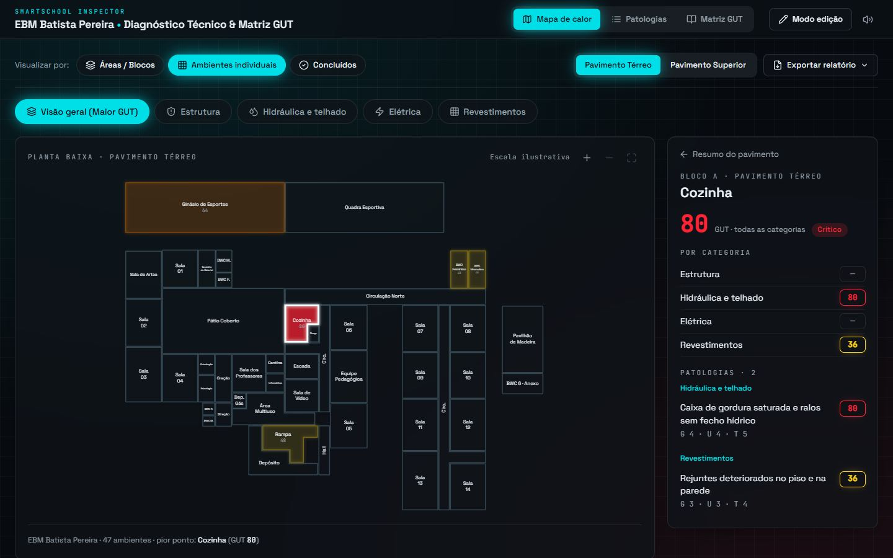
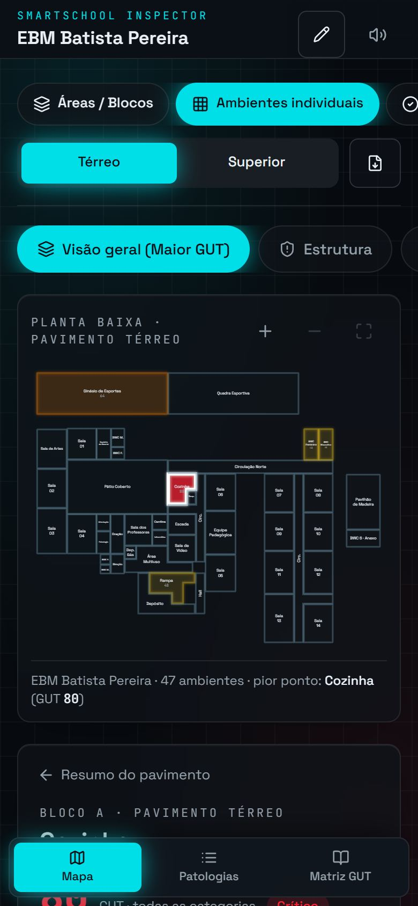
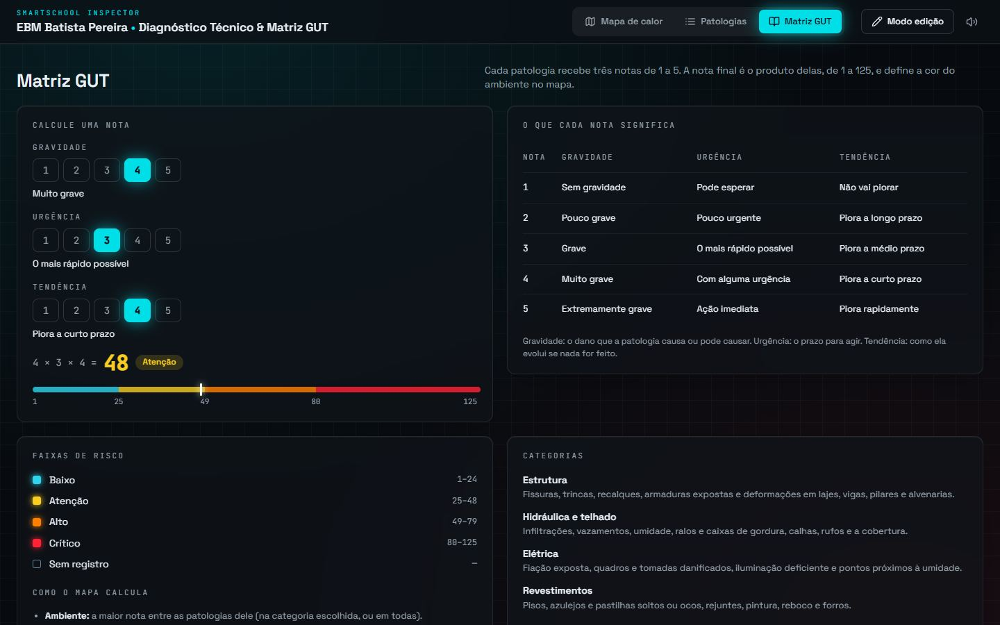

# Mapa de patologias · EBM Batista Pereira

Mapa de calor das patologias prediais da EBM Batista Pereira. A planta de cada pavimento mostra,
ambiente por ambiente, a nota da Matriz GUT (gravidade × urgência × tendência), e cada ambiente
abre a lista das patologias que justificam essa nota.

**Site:** https://mapa-patologias-batista-pereira.netlify.app

| Mapa de calor | No celular |
| --- | --- |
|  |  |

| Patologias | Matriz GUT |
| --- | --- |
|  |  |

## O que o site faz

- **Mapa** (`/`): planta do térreo (blocos A a E) e do pavimento superior (A2), vista por blocos, por
  ambientes ou pelo progresso da inspeção, com filtro por categoria: estrutura, hidráulica e telhado,
  elétrica e revestimentos. Cada ambiente tem link direto, por exemplo `/?ambiente=cozinha`.
- **Patologias** (`/patologias`): todas as patologias numa tabela com busca e filtros, exportação em
  planilha CSV e relatório para imprimir ou salvar em PDF.
- **Matriz GUT** (`/matriz-gut`): o significado de cada nota, as faixas de risco e uma calculadora.

### Como as notas são calculadas

- Patologia: G × U × T, de 1 a 125.
- Integridade do pavimento: 100% quando nenhum ambiente tem patologia, 0% quando todos estão em 125.
- Ambiente: a maior nota entre as suas patologias.
- Bloco: a média das notas das patologias dos ambientes, contando 1 para cada categoria sem patologia.
- Progresso: cada uma das quatro categorias concluídas vale 25%.

| Risco | Faixa | Cor |
| --- | --- | --- |
| Crítico | 80–125 | `oklch(0.65 0.25 25)` |
| Alto | 49–79 | `oklch(0.74 0.19 52)` |
| Atenção | 25–48 | `oklch(0.86 0.17 92)` |
| Baixo | 1–24 | `oklch(0.8 0.13 210)` |
| Sem registro | — | traço da planta |

Toda ação mostra o que vai acontecer antes do clique: passar o cursor sobre um pavimento, uma visão ou
uma categoria mostra a planta como ela vai ficar; passar sobre um ambiente numa lista acende o ambiente
na planta; os botões de zoom desenham a área que vai aparecer; no editor, cada nota mostra o resultado
antes de ser escolhida.

## Rodar no computador

Precisa do [Node.js](https://nodejs.org) 18 ou mais novo.

```bash
cd site
npm install
npm run dev
```

O site abre em http://localhost:5180. `npm test` roda os testes da lógica GUT e da validação dos
dados; `npm run build` gera a versão publicável em `site/dist`.

## Registrar patologias

Os dados ficam em `site/src/dados/inspecao.json`. Para editar:

1. No site, clique no lápis (modo edição) e abra um ambiente no mapa.
2. Adicione, edite ou remova patologias, marque as categorias concluídas e escreva anotações.
   Tudo fica salvo no navegador até você baixar o arquivo.
3. Clique em **Baixar inspecao.json** e substitua `site/src/dados/inspecao.json` pelo arquivo baixado.
4. Publique o site de novo.

O botão **Importar arquivo** carrega um `inspecao.json` recebido de outra pessoa. O arquivo é
validado antes de entrar: ambientes desconhecidos ou notas fora de 1 a 5 são recusados.

Os dados atuais são os exemplos do primeiro levantamento. Enquanto for assim, o site fica fora dos
buscadores (`noindex` em `site/index.html`).

## Estrutura

```
site/src/
├── dados/planta.js        geometria dos ambientes e blocos
├── dados/inspecao.json    registros da inspeção
├── lib/                   regras GUT, dados, relatório, rotas
├── componentes/           planta interativa, painéis, editor
└── paginas/               Mapa, Patologias, Matriz GUT
docs/projeto-do-site.md    intenção, decisões e o que ficou de fora
```

## Créditos

- Plantas e geometria dos ambientes: primeira versão do projeto, feita no Lovable.
- Fontes [Space Grotesk](https://fonts.google.com/specimen/Space+Grotesk) e
  [JetBrains Mono](https://fonts.google.com/specimen/JetBrains+Mono) (SIL Open Font License).
- Ícones [Lucide](https://lucide.dev) (licença ISC).
